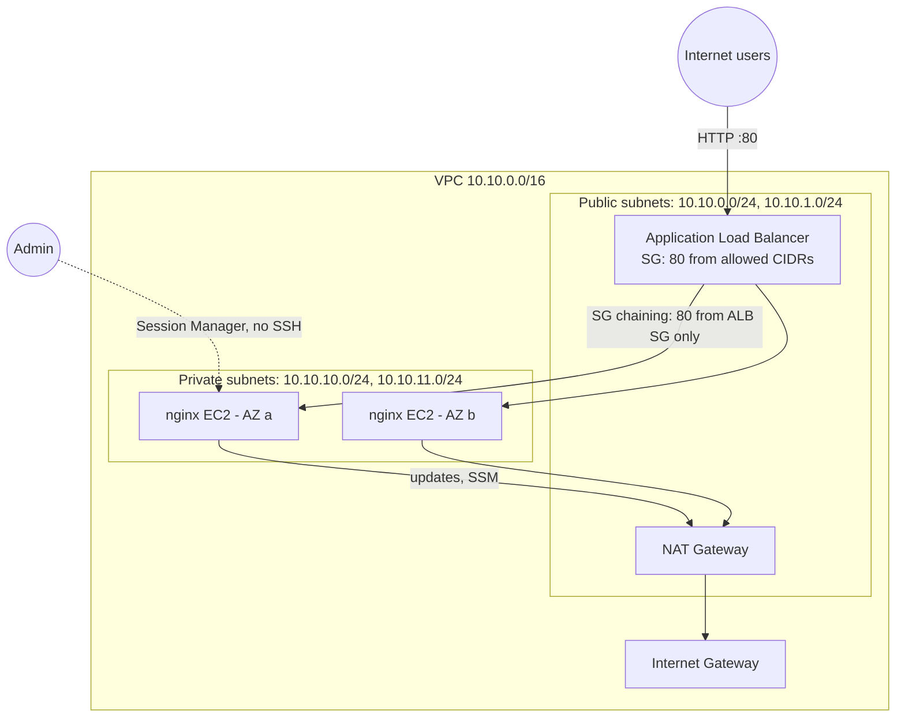

# AWS Highly Available Web Network with Terraform

Production-style AWS network built entirely as code: a **multi-AZ VPC** with public and private subnets, a **NAT gateway**, an internet-facing **Application Load Balancer**, and a self-healing **Auto Scaling Group** of web servers in private subnets. There is no SSH and no public IP on any server: admin access is through **AWS Systems Manager Session Manager**.

> Part of my transition from Enterprise Network Engineering to Cloud & DevOps. The design maps directly to on-prem concepts I have worked with for 8 years (see the table below).

## Architecture



## On-prem networking → AWS

| Enterprise concept | AWS equivalent in this project |
|---|---|
| Campus / data center network | VPC `10.10.0.0/16` |
| VLANs / network segments | Public and private subnets in each AZ |
| Default route to the ISP edge | Public route table `0.0.0.0/0 → Internet Gateway` |
| Source NAT / PAT on the firewall | NAT Gateway for private subnets |
| DMZ firewall rules | Security Group chaining: web servers accept traffic **only from the ALB's security group** |
| F5 BIG-IP virtual server + pool + health monitor | ALB listener + target group + `/health` check |
| Server cluster with spare capacity | Auto Scaling Group across 2 AZs, replaces unhealthy instances automatically |
| Jump host / bastion over SSH | Systems Manager Session Manager (no port 22, no keys) |

## Security highlights

- Web servers live in **private subnets** with no public IPs.
- **Security group chaining** instead of IP-based rules between tiers.
- **IMDSv2 required** on instances (protects instance credentials from SSRF-style attacks).
- ALB **drops invalid HTTP headers**.
- **No SSH**: instance role has only `AmazonSSMManagedInstanceCore`.
- Terraform state in **encrypted, versioned S3** with native state locking.
- **Checkov** security scan in CI.

## Project structure

```
.
├── bootstrap/            # one-time: S3 bucket for Terraform state
├── modules/
│   ├── vpc/              # VPC, subnets, IGW, NAT, route tables
│   └── web/              # security groups, ALB, launch template, ASG, IAM role
├── tests/                # terraform test with a mocked AWS provider (offline, free)
├── main.tf  variables.tf  outputs.tf  versions.tf
└── .github/workflows/    # CI: fmt, validate, test, Checkov
```

## Deploy

**Prerequisites:** Terraform ≥ 1.10, AWS CLI v2 signed in (`aws sts get-caller-identity` works), and an AWS Budget alert.

1. Create the state bucket (once):

   ```bash
   cd bootstrap && terraform init && terraform apply && cd ..
   ```

2. Configure the backend and variables:

   ```bash
   cp backend.hcl.example backend.hcl          # set the bucket name from step 1
   cp terraform.tfvars.example terraform.tfvars
   ```

3. Deploy:

   ```bash
   terraform init -backend-config=backend.hcl
   terraform plan -out tfplan
   terraform apply tfplan
   ```

4. Open the `website_url` output after 2–3 minutes. Refresh the page to watch the ALB switch between instances in different Availability Zones.

5. **Destroy when done** (the NAT gateway and ALB bill by the hour):

   ```bash
   terraform destroy
   ```

## Things to try (and screenshot for your portfolio)

- **Self-healing:** terminate one instance in the EC2 console and watch the ASG launch a replacement while the site stays up.
- **Session Manager:** connect to an instance with no SSH and no public IP:
  `aws ssm start-session --target <instance-id>`
- **Rolling update:** change the page in `modules/web/user_data.sh.tftpl`, run `apply`, and watch the instance refresh replace servers gradually.
- **Lock down access:** set `allowed_cidrs = ["<your-ip>/32"]` and confirm others can no longer reach the site.

## Cost

About **$0.10 per hour** in `us-east-1` while deployed (NAT gateway, ALB, 2 × t3.micro, public IPv4 addresses), so a 3-hour lab session costs roughly $0.30. The state bucket costs a few cents per month. Always run `terraform destroy` at the end of a session.

## Tests

Offline, with no AWS account needed:

```bash
terraform init -backend=false
terraform test
```

The tests check the subnet plan, multi-AZ layout, CIDR validation, IMDSv2, ALB header hardening, and ASG health checks.

## Roadmap

- [ ] HTTPS listener with an ACM certificate and HTTP → HTTPS redirect
- [ ] VPC Flow Logs and CloudWatch alarms (Week 4)
- [ ] GitHub Actions deploy with AWS OIDC (no stored keys) and an LLM review of `terraform plan` on pull requests (Week 4)
- [ ] One NAT gateway per AZ for production resilience

## Skills demonstrated

AWS (VPC, EC2, ALB, Auto Scaling, IAM, S3, Systems Manager) · Terraform (modules, remote state, validation, `terraform test`) · Network design & segmentation · Cloud security · GitHub Actions CI · Checkov
